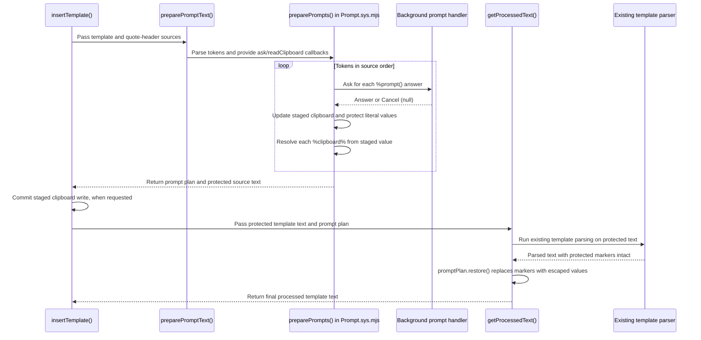

# Template processing and prompt flow

This describes the current SmartTemplates compose path for templates that contain `%prompt()` or `%clipboard%`. It is relevant to the parser-to-MailExtension conversion: the conversion must preserve source order, staged clipboard values, and literal protection across the normal template parser.

## Call sequence

## What happens at each stage

1. `insertTemplate()` obtains the raw template and quote header, then calls `preparePromptText()` with both sources. Prompt interactions are resolved before the previous template is removed or new content is inserted.
2. `preparePromptText()` imports `Prompt.sys.mjs` and calls `preparePrompts()`. Its `ask` callback uses the existing NotifyTools bridge to request the prompt UI from the background. Clipboard reads use the compose utility.
3. `preparePrompts()` parses all sources, checks feature access, then walks prompt and clipboard tokens in source order. An accepted `%prompt(...,toclipboard)%` answer becomes the staged clipboard value. A later `%clipboard%` uses that staged value; if none has been staged, it reads the system clipboard. Later prompts with a `clipboard` default likewise use the staged value when available.
4. Prompt answers and clipboard values are protected in the returned source with private markers. The marker-to-value mapping is held in the prompt plan's `literals` array. This keeps inserted values from being interpreted as template syntax during the next stage.
5. `insertTemplate()` commits a staged clipboard write, if requested, then passes the protected template to `getProcessedText()` along with the prompt plan. For a main template and quote header, they share one plan, so interactions are ordered across the supplied sources.
6. `getProcessedText()` runs the existing SmartTemplates parser on the protected text. At the end, `promptPlan.restore()` replaces the markers with escaped literal values. This is where protected values become visible in the final processed text; their values were chosen earlier by `preparePrompts()`.

## Cancellation and clipboard behavior

The compose prompt UI sends Cancel as `null`; the NotifyTools bridge can deliver that result to the legacy caller as `undefined`. Both are treated as cancellation. When choices were offered, cancellation reports a localized “Prompt cancelled” issue in the compose notification bubble while continuing template processing. For a `%prompt(...,toclipboard)%` token, cancellation resolves to an empty string, stages an empty clipboard value for subsequent `%clipboard%` tokens, and requests an empty system-clipboard write when the plan is committed. Cancel on a prompt without `toclipboard` inserts an empty value for that prompt token and does not change clipboard state.

An accepted empty answer follows the same empty-value path. A prompt without choices permits free-text entry; choices constrain the prompt to the offered list.

## MailExtension conversion notes

- Keep the ordered token walk and staged clipboard state in an extension/background-side module where possible; do not move MailExtension API calls into legacy chrome scripts.
- Keep the prompt UI in the compose extension context and route legacy entry points through the existing notification bridge until the legacy parser path is removed.
- Preserve literal protection until all template parsing that could interpret a prompt answer has completed, then restore the values at the same boundary.
- Preserve source order across the template and quote-header sources passed together by `insertTemplate()`.
- Treat cancellation as a value outcome for the relevant token, not an exception that aborts the template parser.
