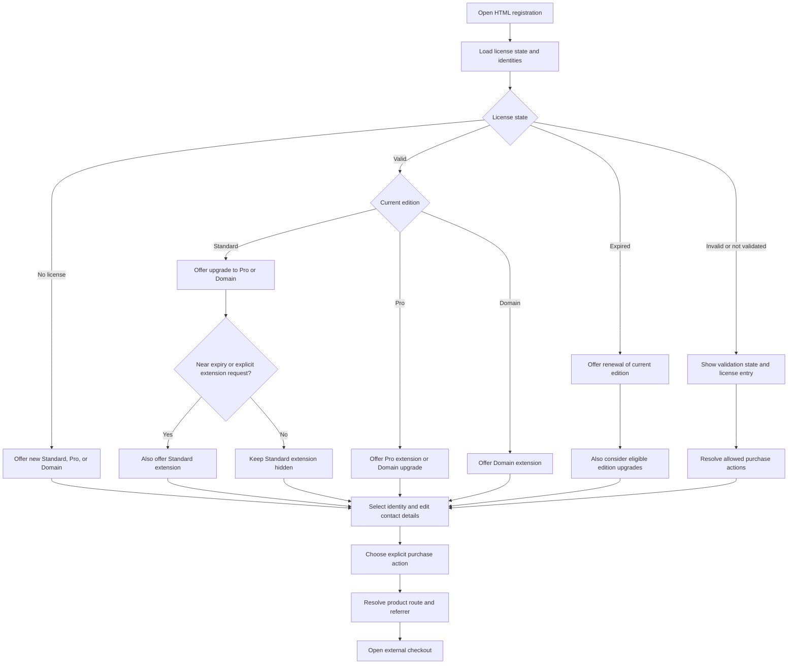
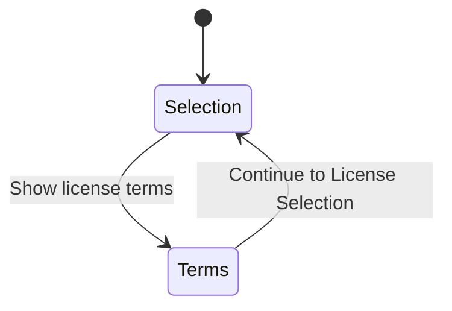
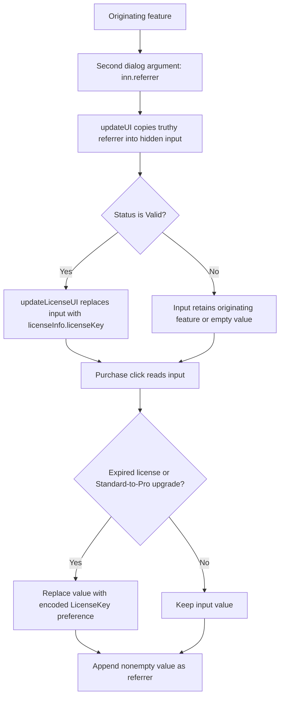

# HTML registration: business logic and implementation plan

Working specification for #445. This document separates requirements from observed legacy behavior and proposed decisions. It does not change the current registration dialog.

## Scope and sources

Build a separate HTML registration page from scratch, initially with fixture data. Keep the existing dialog, callers, namespaces, scripts, and checkout behavior operational until the replacement is reviewed and explicitly adopted.

Sources reviewed:

- [Issue description](description.md): intended functionality across SmartTemplates, QuickFolders, and quickFilters.
- [Current dialog](../../../chrome/content/register.xhtml): content, controls, and default visibility.
- [Current controller](../../../chrome/content/smartTemplate-register-dlg.js): account selection, display rules, and checkout construction.
- [Current entry point](../../../chrome/content/smartTemplate-util.js): `showLicenseDialog(featureName)` passes the originating feature into the dialog.
- [Active FastSpring product inventory](license-products.md): current product entities supplied by the maintainer.
- [Registration localization audit](localization-audit.md): existing registration-key coverage and each locale's declared scope.
- Local shop material in `E:\Dev\Mozilla\Dev\SmartTemplate\shop`: historical product copy and generation script; not guaranteed current.

The observations below describe SmartTemplates. Shared rules can later be reused by the other add-ons, but their product routes and edition differences need separate inventories. Product URLs below are copied from source, not verified against the live shop.

## Responsibilities

The registration page explains annual licensing, displays current license type and expiry, offers appropriate purchases, collects editable licensee details, and opens the shop. It also provides links to premium features and edition comparisons and an entry point for entering an existing license key.

License validation and entitlement calculation remain the background licenser's responsibility. The page consumes its result; it must not infer validity by parsing a key or checking the displayed date. The shop remains responsible for pricing and completing the transaction.

## Inputs and outputs

| Input | Meaning |
| --- | --- |
| License status | Valid, expired, empty, not validated, or another validation result supplied by the licenser |
| License edition | Legacy `keyType`: `0` Pro, `1` Domain, `2` Standard; use named editions inside the new model |
| License details | Existing key, licensed email, expiry date, validation description |
| Mail identities | Account identity identifiers, display name, full name, email, and default identity association |
| Secondary-identity preference | Whether the existing licensed secondary identity may be included |
| Originating feature | Feature that initiated the purchase flow, if any |
| Today | Explicit date input for repeatable expiry-window fixtures |
| Explicit extension request | User clicked the license date in Settings → Licenses; permits early extension independently of the default offer window |

Outputs are a display model with available actions, editable contact fields, and a checkout URL built from an explicitly selected action. Opening checkout, opening help, and opening license entry are separate effects.

## Licensing flows

This chart expresses the intended action model. Domain upgrades are a requirement whose checkout mapping still needs confirmation. Handling invalid and unvalidated keys is also a pending policy decision.

Maintainer clarification: there is no separate Domain upgrade product. The classic FastSpring shop requires manual duplication and pricing management for new product variants, so the replacement must use existing products rather than introduce new upgrade products. The exact existing-product destination for a change to Domain, particularly from an expired license, still needs confirmation.

### Intended action matrix

| Current license | Standard action | Pro action | Domain action |
| --- | --- | --- | --- |
| None | Buy | Buy | Buy |
| Valid Standard | Extend near expiry, or on explicit date-click request | Upgrade always offered | Upgrade: route to confirm |
| Expired Standard | Renew | Upgrade: expired entitlement to confirm | Upgrade: route to confirm |
| Valid Pro | No downgrade proposed | Extend | Upgrade: route to confirm |
| Expired Pro | No downgrade proposed | Renew | Upgrade: route to confirm |
| Valid Domain | No downgrade proposed | No downgrade proposed | Extend |
| Expired Domain | No downgrade proposed | No downgrade proposed | Renew |
| Invalid / not validated | Purchase policy to confirm | Purchase policy to confirm | Purchase policy to confirm |

Suppressing downgrades is a proposal, not an existing requirement. The legacy dialog leaves other-edition purchase buttons available. Confirm this UI policy before enforcing it.

Pro-to-Standard source review: there is no explicit downgrade action, dedicated product, or price-adjustment logic. For a valid Pro license, the still-visible Standard button selects the new Standard product (`product/smarttemplatestandard`) and carries the current key as referrer. For an expired Pro license, the blanket expired-state rule instead selects the Standard renewal product (`instant/smarttemplateStdrenew`), still with the Pro key. This is incidental cross-edition routing, not proof that the shop supports or intends discounted downgrades. The maintainer recalls wanting to discourage downgrade because of the substantial price difference; hiding Standard for existing Pro licensees remains a proposed policy pending confirmation.

For the new UI, identify the existing edition separately from validity: the prototype's summary reads "Standard license" alongside an "Expired" badge and expiry date. Use the same structure for valid licenses (edition, valid status, valid-until date), so expiry never makes a known license edition disappear. This is separate from the legacy registration caption, which does not name the edition.

### Rules observed in the current dialog

- Matching valid editions use the renewal product to extend. Matching expired editions use it to renew.
- Standard licenses show a Pro upgrade action whether valid or expired.
- Valid Standard hides its Standard row unless `expiryDate < today + 30 days`, using an ISO date comparison. Exactly 30 days is excluded by the current strict comparison. A replacement should define calendar-day and timezone semantics explicitly.
- In the registration controller itself, Pro and Domain extension actions have no corresponding 30-day restriction. This is distinct from default extension-offer visibility in Settings.
- The date is displayed in the user's locale. Expired status changes the date label and styling. Empty and not-validated states blank the label; other errors use the validation description.
- License-entry controls are hidden for a recognized valid license with an expiry date; they remain available for expired or missing licenses.
- Expanding annual-license information hides the contact form and purchase actions. Collapsing it restores them. Preserve access to the same information; the new layout need not copy this interaction.
- Feature information links to `https://smarttemplates.quickfolders.org/premium.html`; comparison adds `#featureComparison`.

### Early extension through Settings (maintainer-confirmed)

Clicking the date in Settings → Licenses is an explicit request to extend a Standard or Pro license, including well before expiry. By default, the extension option is shown only shortly before expiry; that visibility window is a prompt policy, not a restriction on eligibility to extend. Standard licensees must always retain the upgrade path. The maintainer confirmed this intent, not a specific day count.

Code inspection finds two different default thresholds:

| Location | Actual comparison | Boundary behavior |
| --- | --- | --- |
| Settings, `html/smartTemplate-settings.js`, valid-license branch | `expiryDate < ISODate(today + 32 days)` | Strictly before the computed 32-day date |
| Registration, `chrome/content/smartTemplate-register-dlg.js`, valid Standard branch | `expiryDate < ISODate(today + 30 days)` | Strictly before the computed 30-day date |

Both compute the future date with local `setDate()` and then take the UTC date through `toISOString()`. These are the exact source comparisons, not guarantees of an elapsed-hour boundary. With aligned calendar dates, Settings can offer extension at 30 or 31 days remaining while registration still hides the Standard extension row. Preserve this distinction in current-behavior fixtures; choosing a common threshold for the replacement is a separate decision.

The replacement must preserve this explicit early-extension entry point. Model the request separately from the originating feature, for example as `intent: "extend"`. For valid Standard, an explicit extension request reveals the Standard extension action even outside the default window, alongside the Pro upgrade action. Extension still uses the edition's renewal product and passes the previous key as referrer.

Source caveat: `html/smartTemplate-settings.js` currently handles the date through `showExtensionButton()`. For a valid Pro or Domain license, it relabels the Settings purchase button to Extend; for Standard, it calls `showLicenseDialog("licenseTab")`. The registration controller then applies its usual Standard 30-day filter without a separate force flag. Thus the visible source does not fully express the confirmed Standard early-extension behavior. Verify that flow at runtime and preserve the maintainer-confirmed intent in the replacement rather than copying this apparent gap. No existing code is changed by this specification.

## Two registration views and toggle behavior

Maintainer-confirmed: every newly opened dialog starts in the shopping/selection view, regardless of license status. This view choice is independent of the license-state action matrix.

| View | Visible content | Toggle label and appearance |
| --- | --- | --- |
| Shopping / license selection (initial) | Shared header and introduction, account selector, editable contact fields, applicable purchase links/buttons | `licenseTerms.show`: "Show license terms"; dark gray button |
| License terms | Shared header and introduction, annual-license explanation, premium-feature and comparison links, updates/expiry explanation, pricing explanation; account/contact form and purchase actions hidden | `licenseTerms.hide`: "🡇 Continue to License Selection 🡇"; red button through the `continue` class |

The current toggle is a reversible view switch, not an acceptance checkbox, checkout step, or requirement to read terms before shopping. It does not change the selected identity, edited contact values, license state, or referrer. The controller only hides and reveals the existing elements, so their values survive a round trip. The top status/date and license-entry area remain outside the switched content.

### Hover feedback and diagonal hatching

The supplied screenshots illustrate the existing feedback. In `smartTemplate-register.css`, `#licenseTermSwitcher:hover` applies both a dashed outline and a repeating diagonal background. The gradient runs at 135 degrees, with alternating six-pixel bands (`#606dbc01` and `#46529812`). Its extent follows the switcher container: a shallow strip around the button in selection view, and the entire terms area plus its button in terms view.

The switcher container uses `pointer-events: none`; the toggle, its links, and `.link` descendants restore `pointer-events: auto`. This deliberately makes the decoration react when interactive descendants are hovered rather than remain active over the whole empty panel. Hovering an eligible link inside the terms container can also activate the ancestor's hover styling; it is not exclusively a button effect.

The gray toggle darkens on hover; the red Continue toggle becomes brighter red. The controller calls `window.sizeToContent()` after switching where available, so the legacy dialog may resize to fit the terms view. The HTML prototype should retain the two views and demonstrate the hatching interaction before any redesign is adopted. Exact XUL sizing is not a requirement for the new page.

### Terms content to review

The screenshots and current strings group the content into Annual License, Updates, and Pricing. They cover premium entitlement, personal/email-bound licensing, using multiple clients and additional addresses, post-expiry behavior, the external shop, and variable pricing.

Maintainer clarification: existing terms, especially descriptions of "premium features", may no longer match current internal behavior. Treat them as draft copy, not an authoritative entitlement specification. Review and verify them separately for SmartTemplates, QuickFolders, and quickFilters before shipping a replacement. Shared terminology does not imply identical feature restrictions, trial behavior, or post-expiry access across add-ons. Historical shop descriptions are not sufficient to resolve those questions.

For each add-on, establish what Standard (where available), Pro, trial, and expired states actually permit; distinguish temporary test access, usage limits, exclusive features, notifications, and any grace period. Trace the relevant enforcement code and verify uncertain cases at runtime, then write clear terms matching those findings. Record unverified claims explicitly rather than silently carrying old wording into the new UI.

Review proposals, not yet approved copy changes:

- Distinguish license duration, access to updates, and access to premium features after expiry; avoid suggesting that add-on updates stop when a key expires.
- Explain Standard versus Pro and Domain clearly, including the difference between testing premium features and unrestricted access. The current introduction says "two licenses" while a Domain purchase option also exists.
- Clarify that additional addresses do not each require a personal license, while the configured licensed address still matters; distinguish this from Domain coverage and seats.
- Keep prices and current discounts in the shop, explaining that country, tax, edition, and existing-license eligibility affect the result.
- Preserve useful comparison/help links and the clear route back to selection. Keep Terms and Continue keyboard-operable, expose the expanded/view state accessibly, and provide focus feedback without relying on hatching alone.

Prototype checks: always open in selection view; switch both directions with mouse and keyboard; preserve edited contact data; keep the header/status stable; verify hatching extent and interactive-descendant hover behavior in both views. Verify the terms remain readable at narrow widths and with reduced motion enabled.

## Caption panel and existing copy

The top row consists of three independent areas: product caption, license status/date, and license-entry controls. In the SmartTemplates registration source, the product caption is always `getSmartTemplate4` ("SmartTemplates License") and the window title is always `licenseWindow.title` (also "SmartTemplates License"). Neither is changed by edition. The changing caption is the middle status label, `licenseDateLabel`.

| Initial license state | Middle label | Date | License-entry controls |
| --- | --- | --- | --- |
| Valid, with expiry | `label.licenseValid`: "Your license is valid until:" | Locale-formatted expiry | Hidden |
| Expired, with expiry | `licenseValidation.expiredDate`: "Your license expired on:" | Locale-formatted expiry | Shown |
| Empty | A single blank space | Hidden if no expiry | Shown |
| NotValidated | A single blank space | Hidden if no expiry | Shown |
| Other validation result | Background `description` followed by `:` | Shown only if expiry exists | Shown |

These are initial-load observations; the legacy updater does not restore every default when status changes. Valid status relies on the original localized label rather than assigning it again. Expired status adds the `expired` class to `LicenseTerm`, giving a white-on-purple gradient and an opacity animation with a five-second delay and three-second cycle. That class is not removed by subsequent updates. The prototype should render each state explicitly rather than preserve these stale-state effects.

The current licenser descriptions for error states are English strings such as "Invalid", "Mail Not Configured", and "Mail Different". Displaying `description` is existing behavior, not evidence that these are localized UI messages. Check actual background output in runtime fixtures.

Use `_locales/en/messages.json` as the starting copy source, especially `getSmartTemplate4`, `label.licenseValid`, `licenseValidation.expiredDate`, `label.haveLicense`, `enterLicenseKey.*`, `licenseTypes`, `intro`, `testDriveS`, `yearlyLicense.*`, `updates.*`, `updatesExpiry`, `pricing.*`, `licenseComparison`, `licenseTerms.*`, and `buy*License.*`. Purchase labels already exist under `notification.premium.btn.*` for renew, extend, and upgrade. Keep message keys associated with the prototype copy so live localization can follow without translating legacy helper namespaces.

The maintainer's implementation decision is to use the add-on-neutral `registration.*` namespace for the independent page. Add these entities to the English catalog only at this stage, recording each adapted legacy entity ID in its `description`. Leave original entities and other locales unchanged. This separates the two UIs for eventual XHTML retirement while keeping the new namespace transferable across add-ons. Resolve `{+extensionName}` through the shared formatter and supply the first-release year from add-on metadata. Shared keys do not require identical feature or licensing claims across add-ons; review those per product. This specification does not authorize changing other repositories.

The two screenshot references embedded in [the description](description.md) are visual starting points. Runtime captures of the scenarios below should settle any differences between the screenshots and this checkout's source. The prototype may display edition explicitly as an improvement; the current top caption does not.

The live [feature comparison](https://smarttemplates.quickfolders.org/premium.html#featureComparison) was read on 2026-11-15. It compares Unlicensed, Standard, and Pro, followed by a separate "Current trial and license restrictions" explanation distinguishing entitlements from actual enforcement and reminders. This is useful context for reviewing the terms copy; it still needs reconciliation with the add-on code. The prototype already links directly to this table via `#featureComparison`. Keep the comparison on the support site rather than duplicating its full table in registration, where it could drift out of date. The maintainer prefers the existing thick Unicode `🡇` arrows on the terms toggle.

## Referrer transport and precedence

There are several existing entry paths, all converging on `showLicenseDialog(featureName)`:

1. Legacy callers pass a feature directly, for example `MAX_STANDARD_CATEGORIES`.
2. Settings sends `{ command: "showRegistrationDialog", addonfeatures: feature }`. The message page similarly reads `addonfeatures` from its URL and sends it to the background.
3. The background forwards it as `detail.params.feature` on `smartTemplates-registration`. Composer notifications also forward their feature through that command.
4. `chrome/content/scripts/st-messenger.js` reads `params?.feature || ""` and calls `SmartTemplates.Util.showLicenseDialog(featureName)`.
5. The utility creates `{ inn: { referrer: featureName, instance: SmartTemplate4 }, out: null }`. Its `openDialog` call passes `SmartTemplate4` as the first extra argument and that parameter object as the second, so the controller reads `window.arguments[1].inn.referrer`.

The controller then uses a hidden text input as mutable state:

`load()` calls `updateUI()` before `updateLicenseUI()`. Although `updateUI()` is declared async, its current body has no await, so the feature is copied before the valid-license overwrite. Subsequent background updates call `updateLicenseUI()` again. Enabling the `premium.licenser` debug option exposes the input, allowing inspection and editing; checkout can still override it for expired licenses and upgrades.

The hidden field therefore does not always contain the final checkout referrer. In particular, an expired license leaves the feature in the input but checkout uses the stored key. A valid license uses the key even for a different-edition purchase. Keep `originatingFeature` and `previousLicenseKey` separate in the new model and resolve precedence when selecting the action, rather than reproducing this mutable hidden-field protocol.

## Identity and contact rules

Maintainer-confirmed edition availability: SmartTemplates and QuickFolders offer Standard, Pro, and Domain. quickFilters offers Pro and Domain, with no Standard edition. Shared page configuration must control both available cards and edition names in explanatory copy; do not display Standard in quickFilters.

The prototype provides a visible email hint ("Your personal license works across multiple devices") and a click/keyboard-operated information flyout beside the email label. Its Standard/Pro explanation ties personal use to the licensed address configured as an account's default identity on each device. Its separate Domain explanation requires an address belonging to the licensed domain. For quickFilters, the personal-license heading must mention Pro only. This describes the normal personal-license setup; the existing secondary-identity preference remains an advanced exception and should not be confused with the default guidance. The flyout closes with its close button, Escape (restoring focus to the trigger), an outside click, or switching to terms.

The current dialog lists each account's default identity. If no default exists, it lists that account's identities instead. Identities without email addresses are omitted. With `licenser.forceSecondaryIdentity` enabled, the first secondary identity matching the licensed email is additionally included. The first resulting item is selected, rather than automatically selecting the licensed email.

Selecting an identity populates editable email, first name, and last name. Legacy name parsing removes parenthesized text, trims whitespace, and takes the first and last space-separated tokens; middle names are discarded. Preserve the ability to edit all fields. Better name handling and preferential selection of the licensed identity are proposals to review, not requirements inferred from the old code.

The replacement must handle no eligible identities without crashing. Fixture mode should include that state, Unicode names, multi-part names, secondary identities, and manual edits. Decide whether an empty identity list permits manual checkout before live integration.

## Checkout contract

All current routes share `https://sites.fastspring.com/quickfolders/`:

| Action | Route suffix recorded in source |
| --- | --- |
| Buy Pro | `instant/smarttemplate4` |
| Renew or extend Pro | `instant/smarttemplate4renew` |
| Buy Standard | `product/smarttemplatestandard` |
| Renew or extend Standard | `instant/smarttemplateStdrenew` |
| Buy Domain | `product/smarttemplate4domain` |
| Renew or extend Domain | `product/smarttemplatesdomainrenewal` |
| Upgrade Standard to Pro | `product/smarttemplateupgrade` |
| Upgrade to Domain | No separate product exists; confirm which existing Domain route applies |

### Confirmed product roles

The maintainer confirmed that buying Standard and renewing Standard use different products. Renewal and extension share the same product within each edition:

| Role | Active FastSpring product name | Legacy URL candidate |
| --- | --- | --- |
| Buy Standard | SmartTemplate Standard | `product/smarttemplatestandard` |
| Renew or extend Standard | SmartTemplate Renewal | `instant/smarttemplateStdrenew` |
| Buy Pro | SmartTemplates Pro | `instant/smarttemplate4` |
| Renew or extend Pro | SmartTemplates Pro Renewal | `instant/smarttemplate4renew` |
| Upgrade Standard to Pro | SmartTemplates Pro Upgrade | `product/smarttemplateupgrade` |
| Buy Domain | SmartTemplates Annual Domain License | `product/smarttemplate4domain` |
| Renew or extend Domain | SmartTemplates Domain Annual Renewal | `product/smarttemplatesdomainrenewal` |

Product names and the Standard/Pro renewal roles are confirmed; the URL candidates remain copied from the controller. The inventory lists names, not URL identifiers, so it does not independently verify these mappings. In particular, the product name "SmartTemplate Renewal" refers to Standard renewal, despite not containing "Standard".

The inventory also includes `ST Domain Seats` and `SmartTemplate Domain Seat`. Their relationship to the Domain purchase and renewal pages is not yet confirmed. Do not expose them as new top-level license editions or independent registration actions.

Historical Domain copy describes a base domain product plus a separately specified user count, a minimum of five users, a matching email domain on each installation, and manually issued keys delivered within 24–48 hours. These details explain possible seat products but must be confirmed before becoming current UI promises. Historical general copy still references SmartTemplate4, mozdev, and addons.mozilla.org; use the existing localization catalog as the UI starting point rather than copying that text wholesale. Do not hard-code prices from the shop files.

Contact parameters are `contact_fname`, `contact_lname`, and `contact_email`. The attribution/entitlement parameter is `referrer`:

- New user: originating feature, when supplied.
- Renewal, extension, or upgrade: previous license key for entitlement and date handling.
- Omit an absent referrer; do not replace a required license referrer with a feature name.

Build URLs with `URL` and `URLSearchParams`, supplying raw values exactly once. The legacy code concatenates contact values directly and sometimes applies `encodeURI` to a license key. That can mishandle reserved characters and should not become a compatibility requirement. Keep real keys and personal data out of fixtures and diagnostic logs.

The current dialog opens checkout in the browser and closes itself immediately. Decide whether the new page should close after a successful open or remain available. A failed open should leave the new page usable.

## Legacy discrepancies to resolve

1. `addRegisterEventListener` accepts only two parameters. Calls passing a third renewal flag have no effect; actual renewal is inferred later from expired state or matching valid edition.
2. Any expired license forces `isRenew`, even if the user selects a different edition. For example, expired Standard plus Domain selects Domain renewal. The new model should use explicit actions and confirmed entitlement rules instead.
3. Valid licenses overwrite the hidden feature referrer with the current key. Expired purchases and Standard-to-Pro upgrades retrieve the key from preferences instead. The replacement needs one authoritative background snapshot.
4. The issue requires upgrades to Domain, and the maintainer confirms there is no separate upgrade product. Reuse an existing Domain product after confirming its eligibility rules; do not invent a product or assume a renewal URL grants upgrade eligibility.
5. Some route comments still say the product must be created; another comment reverses the Standard-to-Pro upgrade direction. Confirm routes independently of those comments before enabling checkout.
6. License updates mutate existing labels, classes, and hidden rows without fully resetting the view. The replacement should derive the complete view from each snapshot so state changes cannot leave stale actions.

## Independent implementation

Use a new directory for the HTML page, stylesheet, controller, and modules. Do not load legacy `SmartTemplate4` scripts or recreate their namespaces. Keep the old registration entry points unchanged while development proceeds.

- **Domain model:** pure functions derive actions from license state, determine identity choices, and construct checkout URLs. Inputs include the date and product configuration so fixtures remain deterministic.
- **View:** accessible HTML renders that model, contact fields, terms, status, and errors. Re-rendering preserves contact edits unless the user changes identity.
- **Fixture adapter:** supplies synthetic licenses and identities, exposes scenario selection, and previews checkout details without opening the shop.
- **Live adapter:** uses standard MailExtension APIs for identities and window/tab operations and direct runtime requests for background-owned license state and preferences. Keep listeners synchronous, returning a Promise only for handled requests. Verify exact APIs and minimum-version support during implementation.
- **Background boundary:** add only narrowly scoped handlers needed by the new page when live integration is ready. Do not add NotifyTools listeners or route existing callers to the new page during this phase.

Product configuration should hold edition availability, shop routes, help URLs, and localized message identifiers. This allows later reuse across add-ons without embedding SmartTemplates assumptions throughout the view.

## Review and verification sequence

1. Review the action matrix and resolve Domain upgrade routing, expired upgrade entitlement, downgrade visibility, invalid-license behavior, and renewal-window boundaries.
2. Build a standalone static UI with synthetic scenarios for every matrix row. Include terms, license entry, account selection, and contact editing. Disable real checkout effects in fixture mode.
3. Implement and test the pure rules, especially the action/route matrix, referrer precedence, reserved-character encoding, expiry boundaries, and transitions between license states.
4. Add the live adapter behind a separate development entry point. Confirm shop routes and minimum-version APIs before enabling transactions.
5. Exercise the replacement in Thunderbird without changing the original dialog's callers. Then review localization in scope for each locale and accessibility, keyboard navigation, theme, and narrow-window behavior.
6. Switch existing entry points only in a later approved integration change. Update release documentation when the feature is prepared for release; no version or build-counter change is needed for this specification.

## Requested runtime checks and pending answers

No purchase is needed for these checks. Use generated test licenses with an address configured in the test profile. Open a fresh registration dialog for each state. Record the top caption/status/date, available purchase labels, and whether license entry is shown. For checkout checks, stop at the shop landing page and report the product path and whether `referrer` represents the feature or previous key; do not paste real keys or personal details.

| Test state | What it resolves |
| --- | --- |
| No key, opened from a known feature | Feature survives the caller path and reaches checkout |
| Valid Standard, expiry more than 30 days away | Hidden Standard row, Pro upgrade, top status |
| Valid Standard and valid Pro, more than 30 days away, date clicked in Settings → Licenses | Explicit early-extension path; Standard extension remains available alongside upgrade |
| Valid Standard, expiry 29 days away and exactly 30 days away | Extension visibility at the boundary |
| Valid Standard, expiry 31 and 32 days away | Settings' 32-day boundary and mismatch with registration's 30-day boundary |
| Expired Standard | Standard renewal product and key referrer; Pro upgrade availability |
| Valid Pro, then expired Pro | Extend versus renew caption/action; Domain destination in each case |
| Valid Domain, then expired Domain | Domain extend versus renew, and top status styling |

Pending business answers:

- Domain: no separate upgrade product exists (confirmed). Which existing Domain destination should Standard/Pro holders use, and does expiry change this?
- Standard: buying uses SmartTemplate Standard; renewal and extension use SmartTemplate Renewal (confirmed). Default near-expiry prompting and explicit early extension through the Settings date are intentional (confirmed). Source thresholds are 32 days in Settings and 30 in registration, both strict comparisons. Decide whether to unify these in the replacement; confirm the legacy URL mapping and investigate the Standard date-click source gap noted above.
- Domain seats: confirm whether existing checkout pages collect the seat count, the current minimum, and whether any of this needs to appear in the registration UI.
- Other proposals in the action matrix remain unconfirmed, including downgrade visibility and purchases from invalid/unvalidated states.

If the observed top caption changes by edition in a runtime test, capture that state: this SmartTemplates registration controller only changes the status/date area. This may identify behavior elsewhere or a difference from another add-on.
